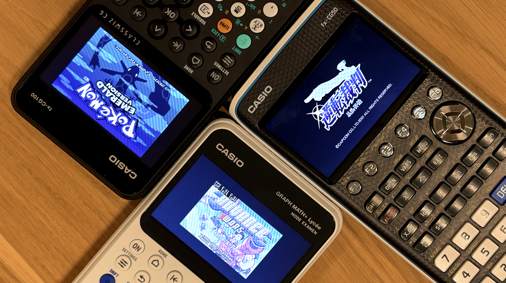

# gpSP for CASIO: A GBA Emulator for CASIO Graphing Calculators

gpSP for CASIO brings GBA games to the **CASIO fx-CG50 / Graph 90+E**, **fx-CG100 / Graph Math+**, and **ClassPad II fx-CP400 / fx-CG500** graphing calculators. This port is based on [gpSP emulator maintained by libretro](https://github.com/libretro/gpsp), with a highly optimized dynamic recompiler ("dynarec" / "JIT") for the calculators' SH-4A CPU. By default, gpSP will apply the Ptune4 overclocking profile F5 for the best speed. With its dynarec and overclocking, many GBA games will run at or close to full speed on the calculator. For more demanding games, automatic or manual frameskip can help keep gameplay smooth.

The dynarec is *fully* vibe-coded using GPT-5.5 / Opus 4.8 / GPT-5.6 Sol / Fable 5 / Gemini 4 Neon. It has been extensively tested to ensure compatibility, although there still can be issues.

## Trimming ROMs

If storage space is tight, larger GBA ROMs such as Pokémon Emerald can sometimes be made smaller by removing unused padding from the end of the file. This can help them fit on the calculator while leaving room for other add-ins. Use the [online gpSP ROM trimmer](https://kararyougi.github.io/gpsp-sh4-jit/). It runs locally in your browser and removes only trailing empty padding; it does not compress or otherwise change the game's data.

Keep a backup of the original ROM before trimming it.

## Features

- SH-4A dynamic recompiler (JIT) - it's the first GBA dynarec for the SuperH architecture!
- ROM picker for `.gba` files in main storage
- Three display sizes and three scaling filters
- Automatic and manual frameskip
- Configurable GBA controls and emulator hotkeys
- 10 per-game savestate slots
- Persistent SRAM, Flash, and EEPROM in-game saves
- Cartridge RTC support for games with time-based events
- Fast-forward and an optional FPS overlay
- Bundled open-source GBA BIOS; no separate BIOS file is required

## Installation

1. Open the [Releases page](https://github.com/KaraRyougi/gpsp-sh4-jit/releases) and download the `.g3a` or `.hh3` file for your calculator. You can also [build gpSP from source](#building-from-source).
3. Copy the `.g3a` or `.hh3` file to the root of the calculator's main storage.
4. (**fx-CG100 / Graph Math+ only**) Download and copy the `mpm.bin` file to the root of the calculator’s main storage. This version of mpm is built from the [dynload branch](https://git.planet-casio.com/PlaneteCasio/mpm/src/branch/dynload), which provides more usable RAM for gpSP.
5. Disconnect the calculator safely, then launch **gpSP** from the main menu.

The calculator builds are model-specific, so make sure you download the right one. gpSP scans for ROMs when it starts; if you add another ROM while gpSP is open, simply restart the emulator to refresh the list. The ROM picker can show up to 48 games, with a maximum size of 16 MiB per ROM.

## Usage

gpSP opens on the list of games. Choose one with the arrow keys and press `EXE` (or `OK` on the fx-CG100) to play. During play, press the menu key to pause:

| Action                                         | fx-CG50 / Graph 90+E | fx-CG100 / Graph Math+ |
| ---------------------------------------------- | -------------------- | ---------------------- |
| Open the pause menu (during play)              | `AC/ON`              | `ON`                   |
| Move up and down (hold to repeat)              | Up / Down            | Up / Down              |
| Change a value; turn a page of the game list   | Left / Right         | Left / Right           |
| Select, open                                   | `EXE`                | `EXE` or `OK`          |
| Go back (in the pause menu: resume the game)   | `EXIT`               | `BACK`                 |
| Settings, from any page                        | `OPTN`               | `SETTINGS`             |
| Exit gpSP (asks first; press it again to exit) | `MENU`               | `HOME`                 |
| Pick a savestate slot in the pause menu        | `0`–`9`              | `0`–`9`                |

The bar at the bottom of every page lists the keys the highlighted row takes, and shows results such as "State saved to slot 3" until you press a key (or for two seconds).

The pause menu has **Resume**, **Save state** and **Load state** (the slot is shown at the end of the row), **Settings**, **Games**, **Restart** and **Exit gpSP**. Restart, Exit and switching to another game ask before they act. Settings are saved automatically when you leave the Settings page; **Colour** under Appearance picks one of eight colour schemes.

### Default key bindings

Want a different layout? Go to **Settings → Key mapping**, highlight a button, press `EXE` (`OK`) and then the key it should use. A key that something else already uses is swapped, so every GBA button always has a key. Only the gpSP menu key is reserved; pressing it cancels.

#### fx-CG50 / Graph 90+E

| GBA control | Calculator key |
| ----------- | -------------- |
| A           | `MENU`         |
| B           | `EXIT`         |
| Select      | `^`            |
| Start       | `VARS`         |
| D-pad       | Arrow keys     |
| L           | `F5`           |
| R           | `F6`           |
| gpSP menu   | `AC/ON`        |

#### fx-CG100 / Graph Math+

| GBA control | Calculator key    |
| ----------- | ----------------- |
| A           | `OK`              |
| B           | `CATALOG` (`CAT`) |
| Select      | `Page Up`         |
| Start       | `Page Down`       |
| D-pad       | Arrow keys        |
| L           | `BEGIN`           |
| R           | `END`             |
| gpSP menu   | `ON`              |

Under **Shortcuts** on the same page you can give keys to **Fast forward**, **Save state**, **Load state** and **Show frame rate**. They start with no key, so they do not interfere with the normal controls; `DEL` takes a shortcut's key away again.

## Display modes

**Settings → Picture size** offers three ways to fit the GBA picture onto the calculator's screen:

| Menu setting | Resolution |       Aspect ratio | What it looks like                                           |
| ------------ | ---------: | -----------------: | ------------------------------------------------------------ |
| Original     |    240×160 |                3:2 | The original GBA resolution, centered with a border and no scaling |
| Full Height  |    320×212 | 80:53 (almost 3:2) | A larger image that stays very close to the GBA's original shape |
| Full Screen  |    384×216 |               16:9 | The largest picture; it nearly fills the screen but stretches the original 3:2 image horizontally |

**Full Height** scales by about four output pixels for every three source pixels; its 320×212 picture nearly fills the screen's height and stays very close to the GBA's native 3:2 ratio. **Full Screen** stretches the picture to a true 16:9 ratio.

For either scaled mode, **Scaling filter** chooses the look you prefer:

- **Smooth** softens the image and blends jagged edges.
- **Sharp** keeps more definition while still using some blending.
- **Crisp** uses nearest-neighbor scaling for hard, pixelated edges.

If a game feels slow, try **Frame skipping: Auto** first. **Manual** gives you a fixed number of frames to skip, while **Off** draws every frame. **Show frame rate** displays both the emulation rate (`E`) and the number of frames actually drawn to the screen (`D`).

The **Limit to 60 fps** option is enabled by default. It keeps games from running faster than the GBA’s native rate. This limit is global regardless of the frameskip setting. It only caps games that would otherwise run too quickly. It cannot speed up a game running below 60 FPS. The **Fast forward** shortcut temporarily bypasses the limit. Turn the option off if you want unrestricted speed or are benchmarking performance.

## fx-CP400 / ClassPad II

There is also a build for the **fx-CP400 / fx-CG500 (ClassPad II)** running
[HollyHock-3](https://github.com/ClasspadDev/hollyhock-3).

Copy `gpSP.hh3` (keep that name) and your `.gba` files to the root of the
calculator's storage and start gpSP from the HollyHock launcher.

gpSP opens on the list of games; tap one to play. Everything can be done by
touch, and the keypad works as well (cursor keys, `EXE`, backspace for back).

| Layout (Settings → Orientation and Picture size) | Picture | Touch keys |
| ------------------------------------------------ | ------: | ---------- |
| Portrait, Original                               | 240×160 | Full pad below the picture |
| Portrait, Full Width (default)                   | 320×212 | Full pad below the picture |
| Landscape, 1.5x                                  | 360×240 | L/R and D-pad on the left; Select/Start and B/A below the picture |
| Landscape, 2x                                    | 480×320 | L, R, Select, Start strip; D-pad and A/B on the keypad |

The printed icons under the screen are shortcuts:

| Icon | During play | In the menus |
| ---- | ----------- | ------------ |
| Menu | Pause menu | Games list |
| Settings | Settings | Settings |
| Esc | | Back |
| Rotate | Portrait ↔ landscape | same |
| Resize | The other picture size | same |
| Swap | Keypad side in landscape; upside down in portrait | same |
| Main | Fast forward while held | |

The Clear key also opens the pause menu, where you can save or load a state,
restart, pick another game or exit.

- **Device rotation** chooses how you hold the calculator: Portrait, turned
  CW or CCW (landscape), or 180 (portrait with the keypad above the screen).
  The interface and the cursor keys turn with the picture.
- **Touch keys** shows or hides the on-screen keys. A key lights up while it
  is held.
- **Screen transfer** chooses how the picture is sent to the panel: DMA runs
  in the background, CPU is faster pixel for pixel but blocks. Which gives
  more frames depends on the game; compare with **Show frame rate**.
- Landscape 2x is pixel-exact but is the slowest layout to draw; use automatic
  frame skipping with it.

Default keys: A=`EXE`, B=`+`, Select=`=`, Start=`x`, L=`Shift`, R=backspace,
D-pad=cursor keys. All of them can be changed under Settings → Change key
mapping, and every GBA button is also a touch key.

**Clock speed** (under Settings) is a built-in Ptune-style page: PLL, FLL,
dividers and memory wait settings, a memory test, and a "keep this?" prompt
that goes back by itself after ten seconds. Changes apply only while gpSP is
running, so the calculator's own software is never left overclocked. No
setting other than stock has been tried on hardware; a setting that is too
fast freezes the calculator until it is reset. If a saved start-up setting
stops gpSP from starting, hold Clear while launching it.

## Save data and savestates

Regular in-game GBA saves are supported and stored in `.SAV` files named after the ROM. gpSP writes new save data to storage when you change games or exit the emulator.

To make sure your latest progress is written safely, exit with **Exit gpSP** (or `MENU` on the fx-CG50, `HOME` on the fx-CG100, then confirm), or load another game before turning off or resetting the calculator.

Savestates are stored in ROM-named `.SVS` files. In the pause menu, pick a slot from 0 to 9 with Left / Right on the **Save state** or **Load state** row (or with the digit keys), then press `EXE` (`OK`). Saving keeps the menu open and confirms at the bottom; loading goes back to the game. If you prefer, you can assign quick-save and quick-load shortcuts for the selected slot.

gpSP forms save filenames from the first six alphanumeric characters in the ROM filename. Make those six characters unique for each game so that two ROMs do not accidentally share the same save files.

Savestates may not work across different gpSP releases, so regular in-game saves are the safer choice for long-term progress.

## Notes and current limitations

- There is no sound support yet.
- Cheats, link cable, wireless, netplay, and rumble are not supported.
- Not every game will work perfectly.
- The built-in overclock is active only while gpSP is running. gint restores the calculator's previous clock settings when gpSP exits or calls the OS.
- If the calculator is already running faster than the built-in profile (for example, a custom Ptune setting with a faster CPU and bus), gpSP keeps that setting instead of lowering it.

## Reporting gameplay issues

Found a crash, graphical glitch, save problem, incorrect behavior, or unusually slow part of a game? Please [open a gameplay issue on GitHub](https://github.com/KaraRyougi/gpsp-sh4-jit/issues/new). Reports from real calculators are especially helpful.

Before opening a new issue, check the [existing issues](https://github.com/KaraRyougi/gpsp-sh4-jit/issues) to see whether someone has already reported the same problem. If possible, also try the latest gpSP release.

Please include:

- Your calculator model
- The gpSP version shown in the add-in information
- The game's title, region, and revision, if known
- What you expected to happen and what happened instead
- Clear steps that reproduce the problem, starting from launching gpSP
- Your display mode, scaling filter, frameskip settings, and any custom key mappings
- For performance problems, the `E` and `D` values from the FPS overlay and the part of the game where the slowdown occurs
- Any error message, photo, or short video that helps show the problem

## Building from source

Calculator builds require [fxSDK](https://git.planet-casio.com/Lephenixnoir/fxsdk) and [gint](https://git.planet-casio.com/Lephenixnoir/gint).

Alternatively, use the pinned Docker toolchain (SH GCC 14.1.0 and gint's
CG100-capable development revision). Start Docker first; on macOS with Colima,
run `colima start`. No host fxSDK installation is needed:

```sh
ports/fxcg100/build-docker.sh cg100
ports/fxcg100/build-docker.sh cg50
ports/fxcg100/build-docker.sh classpad
```

The first run builds the toolchain image; later runs reuse its cached layers.
Model-specific outputs are in
`ports/fxcg100/gint-gpsp/build-docker-cg100/gpSP-cg100.g3a`,
`ports/fxcg100/gint-gpsp/build-docker-cg50/gpSP-cg50.g3a` and
`ports/fxcg100/gint-gpsp/build-docker-classpad/gpSP-classpad.hh3` (rename the
last one to `gpSP.hh3` on the calculator).
The base image digest and gint commit are pinned in
`ports/fxcg100/toolchain/Dockerfile`. The container mounts only this repository
and leaves the host compiler and shell configuration unchanged.

For an fx-CG100 JIT build:

```sh
ports/fxcg100/build-calc-jit.sh
```

Set `FXSDK_PREFIX=/path/to/fxsdk/prefix` if fxSDK is not detected automatically. The script produces `gpSP.g3a` and also places a visible copy on the desktop by default.

For an fx-CG50 / Graph 90+E JIT build:

```sh
cd ports/fxcg100/gint-gpsp
fxsdk build-cg -c -DCGBA_FXCG50=ON -DCGBA_DYNAREC=ON
fxsdk build-cg
```

The resulting add-in is `ports/fxcg100/gint-gpsp/gpSP.g3a`.

For an fx-CP400 / ClassPad II build (gint must be installed for the `cp`
target):

```sh
cd ports/fxcg100/gint-gpsp
fxsdk build-cp -c -DCGBA_CLASSPAD=ON -DCGBA_DYNAREC=ON
fxsdk build-cp
```

The resulting add-in is `ports/fxcg100/gint-gpsp/gpSP.hh3`.

Developers can find the SH-4 JIT design, BIOS/SWI implementation, performance history, and test procedures in the [technical documentation](docs/README.md).

## Credits and license

- [gpSP](https://github.com/libretro/gpsp) and its original contributors
- [gint](https://git.planet-casio.com/Lephenixnoir/gint) and [fxSDK](https://git.planet-casio.com/Lephenixnoir/fxsdk) by the Planet Casio community
- The Ptune overclock profiles by CalcLoverHK and Sentaro21

This project is free software distributed under the [GNU General Public License v3](LICENSE).
