# ClassPad II port

Status: **builds, host-tested, not yet run on a calculator.** Everything
below that depends on hardware behaviour is listed under
[Not verified on hardware](#not-verified-on-hardware).

The ClassPad II has the same SH7305 as the fx-CG50/CG100, so the gpSP core
and the SH-4 JIT are used unchanged. What differs is everything around them:
the launcher (HollyHock-3), where RAM comes from, the screen, the input and
the file API.

| | fx-CG50 / CG100 | ClassPad II |
|---|---|---|
| Add-in format | `.g3a` | `.hh3` (stripped ELF, HollyHock-3) |
| RAM | 8 MiB, fixed regions known safe | 16 MiB, but all of it OS heap or OS data |
| Screen | 396×224, DMA | 320×528 portrait, DMA (not in gint's driver; done here) |
| Input | ~50 keys | 34 keys + resistive touch |
| Files | Fugue BFile, memory-mapped NOR | POSIX-like `File_*`, no direct mapping |

Build option: `-DCGBA_CLASSPAD=ON` with the fxSDK `FXCP` toolchain. It
defines `CGBA_CLASSPAD` and also `CGBA_FXCG50`, because the core is
configured as on the fx-CG50 (gint key codes, RAM-resident hot code); the
ClassPad checks come first wherever the two differ.

## Screen scaling

The GBA picture is 240×160 (3:2). The panel is 320×528, or 528×320 turned.

| Layout | Picture | Scale | Pixels/frame | Notes |
|---|---|---|---|---|
| Portrait 1:1 | 240×160 | 1× | 38,400 | exact pixels, 40 px side borders |
| **Portrait 4:3** (default) | 320×212 | 4/3 | 67,840 | fills the width; exact 3→4 groups, same scaler as the fx-CG "4:3" mode |
| Landscape 1.5× | 360×240 | 3/2 | 86,400 | exact 2→3 groups; leaves a 168 px column and an 80 px strip for a full touch pad |
| Landscape 2× | 480×320 | 2 | 153,600 | exact integer; fills the 320 px height, 48 px left over |

Why these four:

- **The width is the binding constraint in portrait.** 320/240 = 4/3 is the
  largest aspect-true scale; it leaves 316 rows free, which is where the
  touch pad goes. Nothing larger fits without cropping.
- **The height is the binding constraint in landscape.** 320/160 = 2 exactly,
  so 2× is pixel-perfect with no filtering at all: the best picture this
  panel can show. It uses 480 of 528 columns.
- **2× leaves no room for a touch pad**, only a 48 px strip. 1.5× is the next
  ratio down with small integer groups (2→3), and its 360×240 picture leaves
  enough room around it for a D-pad with 52 px cells and 72 px A/B keys.
- **A full-screen stretch (528×320, 2.2× by 2×) was rejected.** It distorts
  the picture by 10 %, needs a 5→11 horizontal pattern, and gains 48 columns.

Cost matters because the LCD bus is slow relative to the frame time; see
[Display transfer](#display-transfer) for the measurements. At the measured
rates the four layouts occupy the bus for about 3.3 / 5.9 / 7.5 / 13.4 ms per
drawn frame with CPU writes and 4.4 / 7.7 / 9.8 / 17.5 ms with DMA, so
landscape 2× cannot be drawn at 60 fps either way and relies on frameskip.

Filters (SMOOTH / SHARP / CRISP) apply to the two non-integer layouts. In
1.5× the only tap that straddles two source pixels sits exactly halfway, so
SMOOTH and SHARP are identical there; CRISP duplicates instead of blending.
2× and 1:1 have nothing to filter.

### Landscape

The panel is scanned in portrait order and the controller is left in its
default address mode, so landscape is done in software: one panel row is one
GBA column. Each frame is emitted column by column (gather a column, stretch
it, repeat or blend whole lines for the other axis). Walking a column touches
160 cache lines 480 bytes apart, which map to distinct sets and are reused by
the next 15 columns, so the walk stays in the data cache.

`LANDSCAPE: KEYS ON RIGHT / KEYS ON LEFT` chooses which way the calculator is
turned. Menus and status screens are drawn by gint on a 320 px wide canvas
and presented turned and centred; the margins repeat the canvas edge so bars
and backgrounds span the screen.

The cursor keys follow the picture: in landscape the key that points up on
screen is read as UP, both in the menu and in the default GBA mapping.

## Display transfer

The OS refreshes this panel by DMA. In OS 02.01.7003 the LCD routines around
0x80039e08 and 0x8003a8fc enable the DMAC (MSTPCR0 bit 21), program channel 0
with the source masked to a physical address, destination 0x14000000 (the
LCD data port, 0xb4000000), a count of bytes/32, and CHCR 0x00101400
(32-byte units, auto request, source increment; 0x00100400 with a fixed
source for fills), then poll TE. gint's R61523 driver pushes pixels with a
CPU loop instead, but its generic DMA driver is present in the ClassPad II
library and supports the same transfer.

`classpad_platform.c` builds the picture in strips of at most 4096 pixels in
the two on-chip RAM banks (X and Y RAM), alternating banks. Strip sizes are
16 rows (1:1), 12 rows (4:3 and 2×) and 15 rows (1.5×), all multiples of 16
pixels. `LCD TRANSFER` in the graphics menu chooses how a strip reaches the
panel:

- **DMA** (default): `dma_transfer_async(0, DMA_32B, ...)`; the next strip is
  computed while this one transfers, and the last strip of a frame stays in
  flight under the next frame's emulation. Every other panel access waits
  for it first.
- **CPU**: the strip is written by a CPU loop.

Menus, the touch keys and the crash report always use CPU writes.

#### Measured on hardware

`ports/fxcg100/classpad-lcdbench` on a ClassPad II with panel ID 0x16, stock
clocks (Iφ 118 MHz, Bφ 59 MHz, Pφ 29.5 MHz), full 320×528 frame:

| Method | Frame | ns/pixel |
|---|---|---|
| CPU loop, source in on-chip RAM (strips) | 14.9 ms | 87 |
| DMA 32-byte units, source in on-chip RAM (strips) | 19.5 ms | 114 |
| CPU loop, source in main RAM | 20.9 ms | 123 |
| DMA 32-byte units, source in main RAM | 21.0 ms | 124 |
| DMA 16-byte units, main RAM | 21.4 ms | 126 |
| DMA 4-byte units, main RAM | 33.3 ms | 197 |
| DMA 2-byte units, main RAM | 54.9 ms | 324 |
| copy from main RAM to a bank + DMA, double-buffered | 23.3 ms | 137 |

While one whole-frame DMA from main RAM ran, a loop that stays in registers
kept 96 % of its idle speed; a loop that misses the data cache on every step
kept 17 %, and the DMA itself took 20 % longer.

What this says:

- DMA does not move pixels faster than the CPU. With the source in on-chip
  RAM the CPU loop is about 30 % faster than DMA.
- Small DMA units are far slower; 32-byte units are the right choice.
- DMA is close to free for code that stays in the cache and expensive for
  code that keeps missing it. DMA comes out ahead of CPU writes only if the
  emulator keeps more than about a quarter of its speed while a strip is on
  the bus (1 − 87/114). Emulation is somewhere between the two extremes
  measured, so neither is ruled out; that is why the choice is a menu option,
  to be settled per game with the FPS readout. The CPU-availability figures
  above were taken with the DMA reading main RAM; the benchmark now also
  measures it for strips out of on-chip RAM, which has not been run yet.

### Tearing

The panel shows its memory row by row about sixty times a second whatever is
being written, and a frame is written row by row too, so the two can meet
part-way down a frame. `classpad_sync.h` avoids that where it can: the
controller is asked which row it is showing (DCS get_scanline, 0x45), and a
frame is started at a moment from which, given how many rows are shown while
one frame goes out (measured on the frame before), the two do not meet.

- On the 0x16/0x52 family the OS sets address mode 0xc0 (rows and columns
  counted from the far end), so logical rows 0..527 are always shown
  bottom-to-top (527 → 0) without probing 0x0b. On the R61523 (360×640
  memory with `SCN = 0` scanning physical rows 0..527), refresh direction
  is read from MIPI DCS `get_address_mode` (0x0b) via
  `((mode >> 7) ^ (mode >> 4)) & 1`, falling back to top-down if two reads
  disagree. Every view orders its strips to follow the panel's refresh
  direction.
- The row count includes blanking rows: 548 a refresh at ~57 Hz on a
  ClassPad II with panel ID 0x16, so 20 rows of blanking for 528 of picture.
  Where in the count the picture lies is not known. `Refresh position`
  (0..15, sixteenths of a refresh, 34 rows a step at 548)
  is set by eye on a page of its own (Settings → Refresh position, shown
  when VSync is on): two high-contrast bars glide smoothly across a calm
  surface spanning every panel row (vertical bars in portrait, horizontal in
  landscape), with only a round back button and the rows/refresh rate badge
  at the top and a pill for the slider at the bottom, so a tear shows as a
  broken bar edge on any row without full-screen flashing. While the page is
  open frames wait with a 24th of a refresh to spare (~23 rows at 555,
  slightly above half a step so a start midway between two stops still
  survives polling jitter, while well below a full step so one step out
  tears), tight-polling each narrow slot across the whole `[lo, hi)` window
  in 16 low-discrepancy steps (`cp_sync_window_probe`: early end, late end,
  middle, quarters, ...). Testing only the early end left positions too high
  clean (0..6 on a 0x16 unit where 0 is right); testing only the two ends
  left an opposite-side false-clean band whenever the forbidden zone was
  narrower than half a refresh (positions 4..12 on a 555-row R61523), because
  both ends cleared the forbidden zone while the middle of the window
  straddled it. Sweeping all 16 slots eliminates that false-clean band on
  both panel families.
- On a bottom-up panel the strips go the way of the refresh, but each one is
  filled from its top row down, against it: its top row is written as it
  starts and its bottom row, the one the refresh comes to first, a strip's
  time later. The window keeps a strip's height clear ahead of the refresh
  and a strip's time behind it, on top of the clearance, with the strip
  height taken from the number of strips the last frame of the same kind
  took. Without that, the 16-row bands of the calibration page used up most
  of its 17 rows of clearance, and for over a third of the places the
  picture could start no step was clean (worked out against a 548-row
  refresh; tested in `tests/classpad_sync_test.c`). On a top-down panel each
  strip is filled in the same direction as the refresh and needs no
  intra-strip margin.
- The counter is read as two bytes while it runs, and the first read after
  pixels were written is often wrong: a row is believed only when two reads
  in a row agree (`cp_scan_agree`). On the R61523 path only, controller
  reads enforce the DBI read cycle time (`trc >= 450 ns`) and `0x45` waits
  `>= 3 µs` after selecting the command and after reading the second byte
  (R61523 Rev.1.01, p.131); the 0x16/0x52 path uses direct bus reads as
  before.
- The game's picture keeps a sixth of a refresh clear at both ends of its
  window, the interface an eighth.
- The first frame sent spends a quarter of a second reading 0x45 to see
  whether it is a row counter at all, how many rows a refresh has and how
  often it comes round, and so does the first frame of the page that sets
  the position. If it is not a counter, nothing else is done. Only reads
  that the next read agrees with count. When every read counted, the same
  unit that counts 548 rows at 56 Hz gave 856 rows at 112 Hz at one start
  and 924 at 92 Hz at another (one wrong read above the last row sets the
  count; each read across a carry counted as a refresh), and the position
  that gave a clean picture moved between starts: a wrong count moves where
  every position falls, since positions are sixteenths of it and taken
  modulo it. Simulated against 548 rows, counts of 856 and 924 made 3, 4,
  both or neither the clean positions, depending on the count and on where
  in the blanking the picture starts.
- `VSync` (Settings, off by default) turns the waiting on.
  It can cost up to one refresh per frame drawn.
- `Refresh rate` (Settings, aligned with fx-CG50 / fx-CG100: `Auto` by default,
  `System`, `59.73 Hz (GBA)`, or `66 Hz` .. `100 Hz`) adjusts the panel's
  timing via the shared `lcd_sync_common.h` solver and Himax-family
  `0xB2`/`0xDF` builder (matching Casio OS 02.01.7003 `0x8003887e` on ClassPad
  `0x16`/`0x52` and OS 02.10 `0x80074ab8` on fx-CG100 `0x32`/`0x52`), or
  `0xC1`/`0xC3` byte 3 behind MCAP `0xB0 = 0x00` on the R61523. In `Auto`
  mode, turning `VSync` on automatically locks the panel to `59.73 Hz (GBA)`
  by jointly solving `(VFP, RTN)` against the unit's measured stock oscillator
  (within ~0.02 Hz of 59.7275 Hz), while turning `VSync` off leaves the OS
  stock rate untouched. High-refresh stops (`66..100 Hz`) keep `VFP = 8` (548
  rows) to maximize the tear-free window. All updates wait for VBlank when the
  row counter is active and restore stock timing when gpSP exits.
- A frame that takes much longer than one refresh to write (landscape 2x)
  cannot be placed and is sent as before.

On a ClassPad II with panel ID 0x16 the counter is there. The first two
versions assumed the refresh ran the same way as the strips, and tore as
before while reporting no tears. The next one gave a clean calibration
page at one position on that unit (4, with a wrong row count), which a
refresh running against the strips could not. With the count right (548
rows, 56 Hz) and the strips kept clear, positions 0 to 6 looked clean
while the page still tried only the early end of the window, and 0, the
lowest of them, is the right one, as 20 rows of blanking would suggest:
the picture starts within half a step (17 rows) of where the count does.
0 is the default. With frames starting at both ends of the window, the
page showed only 0 clean on that 0x16 unit, every other position tearing.
On an R61523 unit, `0x45` measured **555 rows at 60 Hz** (528 visible +
27 blanking) and the two-end calibration exposed the opposite-side
false-clean band across positions 4..12, which motivated the 16-slot
full-window sweep (`cp_sync_window_probe`); default position remains 0.

### Backlight

The backlight is driven by the display controller on both panel families,
and the OS sets it there (0x80038550 brightness, 0x8003861e PWM rate):
DCS 0x51 and the middle of 0xc9 on the 0x16/0x52 family, 0xb9 on the
R61523 (behind MCAP 0xb0, which is unlocked to `0x02` for `B1h–BFh` only
and restored around every access, and validated before any write). The
system's 14 brightness steps write 11..103 of 255, and it never moves the
PWM rate off the first of the ten settings in its own table.

Settings has `Backlight` (1..16, 16 = 255; 0 leaves the system's) and
`Backlight PWM rate` (`System`, or `430 Hz` .. `33300 Hz` across 9 steps on
both families). Both are put back when gpSP exits. Because the calculator's
LED boost driver needs an ~8–9 µs minimum turn-on pulse, high PWM rates
enforce a minimum `Backlight` floor (`33300 Hz` ≥ 5, `27400 Hz` ≥ 4,
`18300 Hz` ≥ 3, `13700 Hz` ≥ 2, `6860 Hz` ≥ 1) in both the UI and
`fxcg100_lcd_set_backlight()` so no combination can black out the screen.
On the R61523, rate 9 (`PWMDIV = 0x00`, 33.3 kHz) limits PWM duty
resolution to 210 steps (R61523 Rev.1.01, Table 54 Note 2), so brightness
14..16 saturate at full duty; rate 8 (27.4 kHz) preserves all 256 steps.
The R61523 path follows the datasheet and OS code and has not yet been run
on hardware.

### Two panel families

The ClassPad II exists with two LCD families, told apart by ID register 0xda.
The OS (LCD_SetDrawingBounds, 0x80038a10) reads it and adds 40 to the X
window bounds unless the ID is 0x16 or 0x52; its power-on sequence also
branches on the same test.

| ID (0xda) | Controller | First visible column |
|---|---|---|
| anything else (0x00 on known units) | Renesas R61523, 360×640 memory | 40 |
| 0x16 or 0x52 | not the R61523; part numbers not identified here | 0 |

Both take the same window (0x2a/0x2b) and memory-write (0x2c) commands,
which is all gameplay needs once the OS has initialised the panel, so the
presenter only has to apply the offset. It does this itself, following the
OS.

gint's `r61523_win_set()` tests `id != 0x16 || id != 0x52`, which is always
true, so gint asks for columns 40–359 on every panel. On a unit with panel
ID 0x16 a full-screen `dupdate()` was nevertheless seen correctly aligned
right after this code had set a full-screen window. The likely reason, not
confirmed, is that the 0x16 controller rejects the out-of-range request and
keeps the window it already had. That would make gint's output land in
whatever window was set last, so gpSP does not use gint to push pixels at
all, including for the crash report.

## Touch keys

`ports/fxcg100/classpad_layout.h` holds one key layout per display mode, in
the coordinates the player sees, plus the transform to panel coordinates.

| Portrait 1:1 | Portrait 4:3 |
|---|---|
| 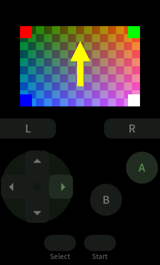 | 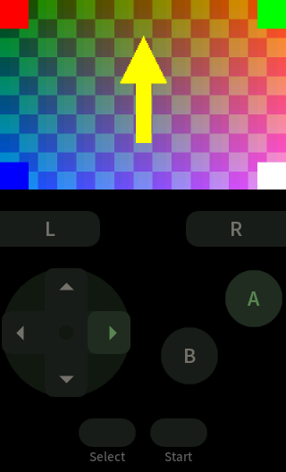 |

| Landscape 1:1 | Landscape 1.5× |
|---|---|
| 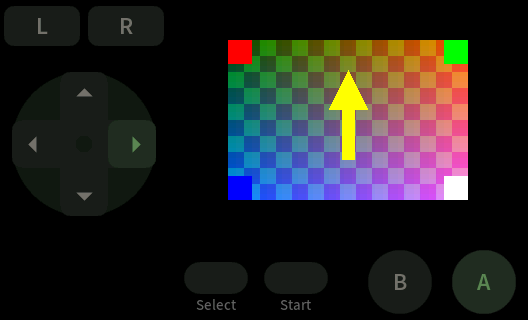 | 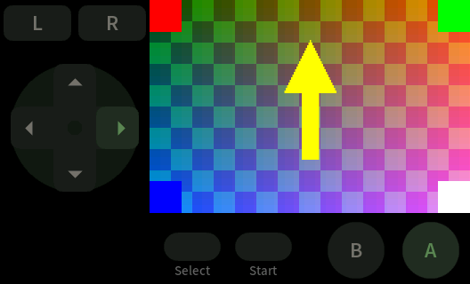 |

| Landscape 2×, CCW | Landscape 2×, CW |
|---|---|
| 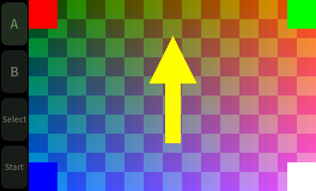 | 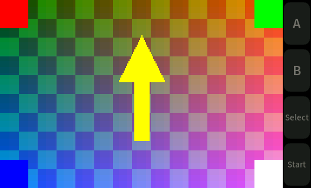 |

Each key has two rectangles:

- **frame**: what is drawn. The D-pad is a 144 px cross (about 29 mm at this
  panel's ~128 ppi), A and B are 64 px circles (13 mm).
- **hit**: what registers a touch. It contains the frame and extends past it
  where there is room, never less than 46 px in either direction. Hit
  rectangles never overlap each other or the picture, and the space between
  them presses nothing. In portrait that includes a 16 px gap between the
  D-pad's and B's touch ranges (34 px between what is drawn), so a thumb
  landing between them triggers neither. The shoulder keys register exactly
  where they are drawn and nowhere else.

The D-pad is one key: its frame is split in thirds, the outer thirds are the
directions (out to the hit rectangle), so the corners give diagonals and the
hub is dead.

- gint's key scanner samples the touch panel at 128 Hz. Each frame the latest
  sample is mapped to keys and merged into the GBA buttons alongside the
  physical keys.
- **A held key is repainted pressed** and repainted normal on release; only
  keys whose state changed are redrawn. A button held from the keypad lights
  its touch key in the same way. On the D-pad only the pressed arms
  change. The keys are kept dim next to the picture: the faces are
  the scheme's surface tones taken about a third of the way to black, the
  labels a muted text colour, and the pressed tone is the idle face moved about
  a tenth of the way to the scheme's primary colour (`CP_KEY_DIM`,
  `CP_KEY_INK_MIX`, `CP_KEY_LIT_MIX` in `classpad_theme.h`): enough to
  confirm the press, well short of the primary colour itself. The change is immediate, not animated.
- Key colours come from the interface's colour scheme.
- Shapes are drawn with anti-aliased edges against the black background, so
  no blending is needed at run time.
- Up to two touch points are used. The panel is resistive, so the second
  point is an estimate; combinations such as D-pad + A are more reliable
  with one of them on a physical key.
- `TOUCH KEYS: OFF` hides the pad and ignores touches.

Portrait 1:1 and 4:3 use the same pad in the same place, so changing the
picture size never moves a key. The 1:1 picture sits against the bottom of
the space the 4:3 one fills, next to the keys.

Which way the calculator is held is chosen in Settings ("Device rotation":
Portrait, CW, CCW, 180). The Rotate icon steps through the first three, and
Swap turns portrait upside down and back. CW means the calculator is turned
clockwise, which puts the keypad under the left hand; CCW is the other way
round; 180 is portrait with the keypad above the screen, where the picture,
the touch keys, the interface and the cursor keys are all turned half a
turn. In landscape 1.5× the D-pad sits high in the left
column, where the thumb rests when the calculator is held by its ends. 

Landscape has three picture sizes. 1:1 is the 1.5× layout with the picture
at its own size, in the middle of the space the 1.5× picture fills. 2× only has room for a 48 px strip, which
carries A, B, Select and Start; the D-pad and the shoulder keys are on the
keypad. The strip is on the side away from the keypad, under the free
thumb: on the right when the calculator is turned clockwise, on the left
when counter-clockwise. gpSP always starts in portrait, the way the calculator is held to start it:
with a landscape or upside-down view saved from last time, the interface is
drawn upright until the first game starts, which then gets the saved view
back.
Turning the screen by hand before that takes effect at once. The Resize icon steps through the sizes of the
current orientation; turning keeps 1:1 as 1:1 and takes the larger sizes to
the largest of the other orientation.

### Icon strip

The printed icons under the LCD (Settings, Menu, Main, Resize, Swap, Rotate,
Esc) are part of the touch panel, not of the key matrix: a touch there is
reported as a point below the last LCD row. The icon centres used are the
ones the OS accepts (x = 23, 69, 114, 160, 206, 251, 297; taken from
casio-emu's ClassPad backend). Measured on a calculator with LCD Bench's
touch probe they come out 3–9 px further right, at y = 557–560, inside the
same cells.

The strip is deliberately hard to press by accident, since Select and Start
sit just above it in portrait:

- rows 528–545 are left unassigned, so only the lower part of an icon counts;
- the touch has to have begun on the strip (sliding down off the screen onto
  an icon does nothing);
- it has to be on the same icon for two polls running.

| Icon | In a game | In the menu |
|---|---|---|
| Menu, Settings | open the gpSP menu | — |
| Esc | — | back |
| Rotate | portrait → CW → CCW → portrait | same |
| Resize | the other scale of this orientation | same |
| Swap | keypad side in landscape; in portrait, turns the picture, the touch keys and the keypad directions upside down | same |
| Main | fast forward while held | — |

There is no on-screen menu key any more. Clear also opens the menu, until
the key mapping gives it to something else; it can be mapped like any other
key now that the icons are there.

## Memory

HollyHock-3 loads every `PT_LOAD` of the ELF to its address with no checks.
The one area an add-in may be loaded into is the OS "VRAM backup" buffer
(0x8c052800, 330 KiB). gpSP needs about 5.4 MiB at fixed link addresses for
the JIT caches, GBA memory and the hot emulator code. No multi-megabyte
region is documented as free; the rest of RAM is OS data or the OS heap
(0x8c280000–0x8ce80000), and OS file calls allocate from that heap.

So the image is split (`gint-gpsp/classpad_gpsp.ld`):

- **low** (0x8c052800): gint, menu, storage, start-up code, read-only data,
  `.data`, and the `.bss` of gint/libc. About 180 KiB. Loaded by the launcher.
- **arena** (0x8c880000–0x8ce00000): hot emulator code, all other `.bss`, the
  emulator state. In no program header, so the launcher never touches it.

At start-up `gint-gpsp/src/classpad_loader.c`:

1. reserves one OS heap block that contains what is linked into the arena
   (`classpad_heap.h`). The heap is read first and only requests known to
   succeed are made, because the OS answers a request it cannot meet with
   an "Insufficient System Memory to Run" dialog rather than NULL, and
   because where a block lands depends on the heap's history: on a fresh
   heap it comes from above the break, on every later start of gpSP it is
   cut from the top of the area the previous run gave back. On a fresh heap
   the break is first raised to 0x8ce40000; after that the block runs from
   the arena's start to the end of the free area around it. If something
   else is in the way, gpSP shows a message and exits without having asked
   for anything. The allocator's state (`head`, `brk`, `limit`, `unit`) is
   discovered dynamically by following PC-relative literals from `Mem_Malloc`
   in HollyHock-3's symbol table (working across OS 02.01.2000, 02.01.7002
   and 02.01.7003 without hardcoded addresses), and `Mem_SbrkMode(1)` is set
   around reservation so any out-of-memory fallback returns `NULL` instead of
   raising the OS dialog;
2. clears the arena and reads both `.cgba.core` and `.ilram` out of its own
   `gpSP.hh3` (found through the ELF section headers; neither is in a
   `PT_LOAD` segment, so launchers that restrict `PT_LOAD` to SDRAM
   `0x8c000000..0x8d000000` accept the ELF), then compares a build stamp
   linked into both halves;
3. copies the staged `.ilram` dispatch stubs into `0xe5200000` and tells
   gint to save/restore ILRAM around OS calls, since gint cannot reload it
   from the image on this model.

### ROM

`\fls0` is the same Fugue file system as on the fx-CG: FAT16 with 4 KiB
clusters, placed so that a cluster is one 4 KiB flash unit. The OS also has
the routine that returns the flash address of the block at a file offset,
which is what `Bfile_GetBlockAddress` is on the fx-CG. HollyHock-3's symbol
table calls it `File_GetAddr`. In OS 02.01.7002 and 02.01.7003 (fx-CP400
and fx-CG500) it is at the same address with the same code:

| Address | What |
|---|---|
| 0x80058c88 | `File_GetAddr(int fd, int offset, void **address)`; masks interrupts, calls the next |
| 0x8005876a | checks and splits the fd (as the read call does), calls the next |
| 0x80047c18 | Fugue core routine; the same instructions as 0x80167358 in the fx-CG100 OS, which is what `Bfile_GetBlockAddress` ends in there |

gint binds only the symbols it wraps (`Mem_Malloc`, `Mem_Free` and 14
`File_*` calls), not `File_GetAddr`. So the ELF entry
(`cgba_hhk3_entry`) looks `File_GetAddr` and `File_Open` up in the table the
launcher passes in `envp` (`HHK_SYMBOL_TABLE`, `HHK_SYMBOL_TABLE_LEN`), before
gint starts and before the arena can overwrite the launcher's memory. The table
must start with the OS guard string at 0x814fffe0; a later entry with the same
name (from the launcher's override file) wins, as in gint.

Before calling it, `cp_hhk_resolve_file_getaddr()` (`classpad_hhk.h`) checks the
code there: the whole entry routine, that it sets SR.BL and IMASK, the
forwarding routine up to its jump into the core, and the core's
cluster-to-sector arithmetic. It follows the PC-relative literals that link the
three rather than using fixed addresses, so the same code at another address
passes. On OS 02.01.2000, HollyHock-3's `addresses.json` points `File_GetAddr`
at the inner forwarding routine (`0x80057c6a`) instead of the outer
interrupt-masking wrapper (`0x80058188`); `cp_hhk_resolve_file_getaddr()`
detects that and locates the verified outer wrapper that calls it (and can also
locate it relative to `File_Open` if `File_GetAddr` is absent from the symbol
table, falling back to `0x80058c88`). If it matches, every block of the ROM is
mapped where it lies in flash, as on the fx-CG100, and the addresses are asked
for again after anything is written to storage. No RAM is used for the ROM and
nothing is paged.

If it does not match, the RAM pool below is used instead.

The part of the block below the arena is the ROM pool. Its size depends on
how much heap the OS already uses, up to about 5.7 MiB when the heap is
nearly empty:
the ROM is read into it at load time and those pages are used directly.
ROM beyond the pool is demand-paged through file reads into the existing
1 MiB page cache, so larger games work but with paging pauses.

The block is freed when gpSP exits.

## Storage

`ports/fxcg100/classpad_bfile.h` wraps the ClassPad file calls in the
Fugue-style signatures the storage code already uses, so config, saves,
savestates and the ROM list share one implementation with the fx-CG models.
File calls run inside `gint_world_switch()`.

## Interface

The fx-CG list menu is not used on the ClassPad. `ports/fxcg100/classpad_ui.c`
is a touch interface with the same entry points (`fxcg100_menu_init`,
`fxcg100_menu_run`, `fxcg100_menu_should_blit`), so `main()` is shared.

| Games | Now playing | Pause menu | Dialog |
|---|---|---|---|
| 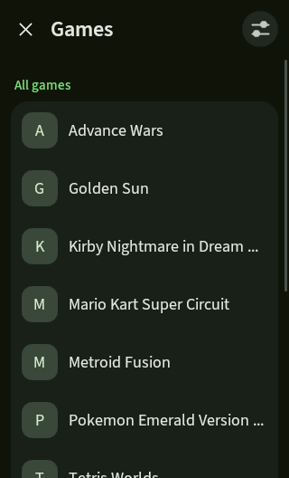 | 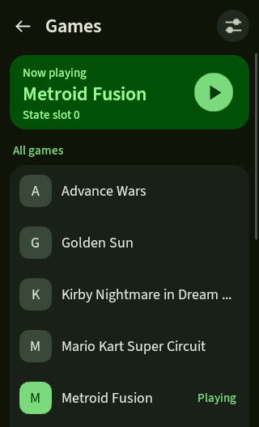 | 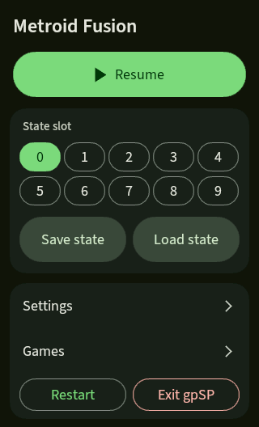 | 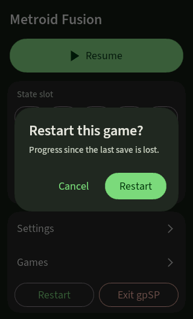 |

| Settings | Appearance | Another scheme | Key mapping |
|---|---|---|---|
| 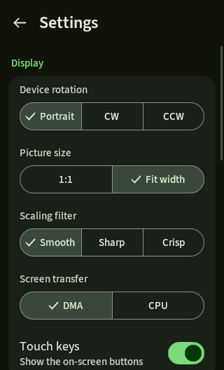 | 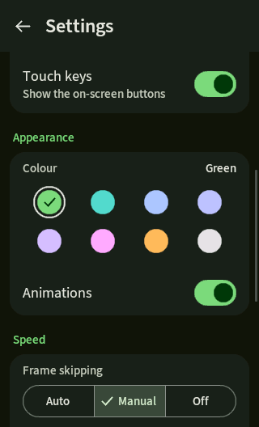 | 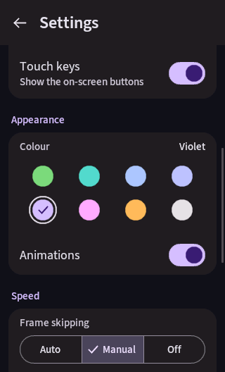 | 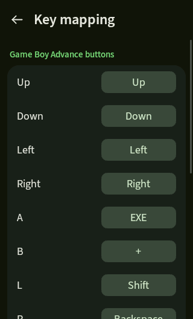 |

| Pause menu, landscape | Settings, landscape |
|---|---|
| 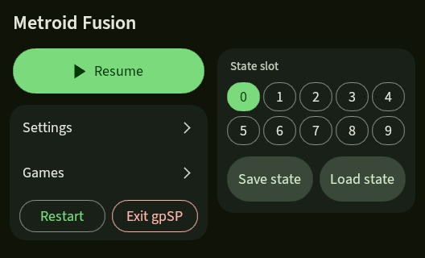 | 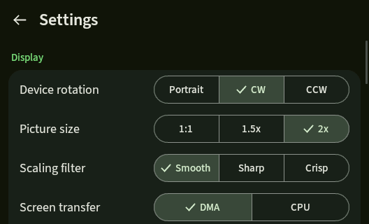 |

- **Games** is the first screen: one row per `.gba`, tap to start, drag or
  flick to scroll. With a game running, a card at the top goes back to it.
- **Pause menu** (Menu icon or Clear during play): resume, the ten state
  slots as chips with save and load, settings, games, restart and exit.
  Restart and exit ask first.
- **Settings**: segmented buttons, switches and steppers that apply at once.
  Changes are written to the config file when the page is left.
- **Key mapping**: tap a function, press the key for it. A key already in use
  moves to the new function, and a message says which one was left without
  a key. Any function can be set to no key; the GBA buttons are on the touch
  screen as well.

### Look

The look follows Material 3 (dark): tonal surfaces, cards, filled / tonal /
outlined buttons, segmented buttons, switches, dialogs over a scrim, a
snackbar for short messages.

- **Colour schemes** (`classpad_theme.h`): eight sets of colour roles, each
  built around one primary colour with the surfaces and text tinted towards
  it. Green is the default; Settings → Appearance → Colour switches between
  Green, Teal, Blue, Indigo, Violet, Magenta, Amber and Mono. The interface
  only asks for roles, so a scheme changes every screen and the touch keys.
- **Text** is Source Sans 3 in three sizes: 15 px Medium for labels, 18 px
  Regular for body text, 24 px Semibold for titles (2.9 / 3.5 / 4.7 mm at
  this panel's ~128 ppi). Glyphs are rasterised ahead of time to tables with
  4 bits of coverage per pixel (`classpad_font.h`, generated by
  `tools/classpad_font_gen.c`; SIL Open Font License, `fonts/OFL.txt`).
  Light text on a dark ground gets extra ink in partly covered pixels
  (coverage^0.6, `cp_text_ink_light` in `classpad_gfx.h`), because blending
  RGB565 values directly makes thin light strokes come out too dark. The
  smallest size is Medium because a Regular stem at 15 px is barely over a
  pixel wide. Text is sentence case, ASCII only.
- **Spacing**: a control's name sits 8 px above it, a section label 8 px
  above its card.
- **Icons** (back, close, settings, chevron, check, play) are drawn from
  anti-aliased lines and triangles in `classpad_gfx.h`; there are no bitmaps.

### Motion

Everything is timed by a 128 Hz tick count rather than by frames, so it
takes the same time whatever a frame costs. The count comes from a timer;
the RTC is used instead only once it has been seen to move, because nothing
guarantees it runs on this calculator. While something is moving, each step
also advances the interface's time by at least a frame's worth, so an
animation ends even if the count stood still. Settings → Appearance → Animations turns
all of it off.

| What | How | Time |
|---|---|---|
| A screen coming in | fades in and slides 40 px, from the right going deeper and from the left going back; the menu itself fades in from black | 200 ms |
| A press | a translucent layer spreads from the finger over the control, and fades after release | 220 ms + 160 ms |
| Switch, segmented button | the thumb / the filled segment slides to its new place | about 150 ms |
| Dialog | rises 28 px into place while the page under it darkens | 160 ms |
| Colour scheme change | every colour cross-fades | 250 ms |
| Snackbar | slides up, stays 2.5 s, slides away | |
| Scrolling | a flick keeps the list moving and slows it down; keypad focus scrolls smoothly into view | |
| Clock confirmation | a bar runs down with the ten seconds | |

Most of this costs nothing per pixel. A screen fades by being drawn with a
colour scheme part-way to the background (`cp_theme_toward`), darkens under a
dialog the same way, and slides by an offset on the drawing surface, so no
pixel is blended that would not have been drawn anyway. Only the press layer
blends, and only over the one control.

While something is moving every step is a full redraw and a full-frame push
(about 15-21 ms for the push alone at stock clock, from the benchmark above),
so the frame rate of the animations on the calculator is bounded by that; it
has not been measured.

How it is built:

- Every control is at least 40 px tall, with a touch area that takes the
  space around it where there is room. The keypad works throughout as a
  fallback for touch: cursor keys move a focus ring and change values, `EXE`
  activates, backspace goes back.
- Screens are drawn into gint's VRAM in panel order for the current
  orientation (`classpad_gfx.h`), so one layout code serves 320×528 and
  528×320 and presenting is a plain full-frame push. Layouts adapt to the
  width: the pause menu goes from one column to two, setting rows from
  stacked to side by side.
- It is immediate-mode: a step reads the input, redraws the screen, and the
  widget calls report taps. Nothing is redrawn while there is no input and
  nothing is moving. `cp_ui_step()` is separate from the blocking loop so the
  host test can drive it.
- A dialog is drawn over its page: the page is drawn first with a darkened
  scheme and with the input withheld, then the dialog on top.
- A card's height is not known until its rows are drawn, so each row paints
  its own strip and the corners are rounded off afterwards (`cp_corner`).
- Status messages from `main()` (loading, saving a state) are shown as a card
  in the same style.

### Clock speed

Settings → Clock speed is a Ptune-style page inside gpSP
(`classpad_clock.h` for the register arithmetic, `screen_clock()` for the
page). It exists because overclocking with a separate tool leaves the OS
running fast, and the OS touch driver then stops responding, so gpSP could
not be started any more. Here the change is made inside gint, and gint puts
the OS's own settings back around every OS call and when gpSP exits.

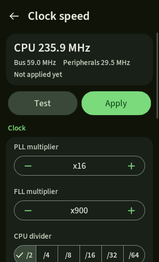

The page works the way Ptune4 does (the method and tables are Xtune/CPtune4's,
by way of the Windows CE port's cetune): the clock chain is set by hand, and
everything that has to follow the resulting clocks is worked out from it.

- The card at the top shows the CPU, bus and peripheral frequencies the
  chain adds up to, and any reason the setting cannot be applied. **Test**
  and **Apply** are right under it; **Restore stock** is at the end of the
  page.
- **Clock**, set by hand: PLL and FLL multipliers and the CPU, SuperHyway,
  bus and peripheral dividers. A divider moves its neighbours so the chain
  stays legal (equal ones follow, and a ratio table drags the rest). A
  multiplier that would push the peripheral clock over its limit steps that
  divider down. A step past a limit is refused and says which: PLL output
  800 MHz, CPU 275, SuperHyway 180, bus 134, peripherals 50.
- **Set automatically**, shown but not editable:
  - the flash read wait and the SDRAM TRC, from the bus clock (the lowest
    setting whose measured ceiling, less 5 %, covers it). The tables give the least each can be, and the
    calculator's own setting is not always that low, so stock is a second
    reference: a faster bus than stock's never gets less than stock has, a
    slower one never more, and the same bus clock keeps the stock waits
    exactly. The page shows the stock value beside each;
  - the touch controller's I2C dividers, from the peripheral clock, so the
    bus stays at or below the 393 kHz it has at stock
    (`cp_clock_i2c_counts`). gpSP's own touch read sets them before every
    read.
- For the setting in use, the card also shows the processor speed as
  **measured**: rounds of a register-only loop in a quarter of a second
  timed by an ETMU (those timers count the 32 kHz crystal, so their rate
  does not follow the clock settings), compared with the same count taken
  on the stock setting. The other figures are only what the registers say; if
  the two differ by more than a tenth the line is in the warning colour.
- The chain is always kept inside Xtune's default limits (PLL output
  800 MHz, CPU 275, SuperHyway 180, bus 134, peripherals 50): the same for
  every model except for the peripheral clock, and meant as a cautious range
  rather than as what the hardware can do. There is no switch to go past
  them; the wait tables end at a 130 MHz bus.
- A setting made on the page always has the fx-CG F5 profile's idle cycles
  on the SDRAM and flash buses (none between accesses of one kind, two
  around a change of direction or device). Only **Restore stock** gives the
  calculator's own.
- **Restore stock** puts back the chain the calculator had when gpSP
  started.
- The multipliers have "−" and "+" (the FLL moves by ten), and a tap on the
  value picks the multiplier for the keypad: left and right change it by
  one, up and down by ten for the FLL (by one for the PLL), EXE or back ends
  it.
- **Test** switches to the setting, runs for a few seconds and switches
  back: 64 KiB of RAM written and read back through the uncached mirror
  (four patterns, 48 passes) and then through the cache in a scattered
  order; and a signature that must match the one taken on the running clock
  just before, made of a checksum of 2 MiB of the OS in flash read uncached,
  a checksum of the emulator code in RAM, and the result of a long
  calculation. The result (and which part failed) stays in the card at the
  top for as long as the page shows the setting that was tested. Passing
  does not prove a setting stable, only that it survived those seconds.
- **Apply** switches and asks "Keep this speed?" with a ten-second
  countdown; doing nothing restores the previous setting. A kept setting is
  saved to `GPSPOC.CFG`.
- **Apply when gpSP starts** (on by default) re-applies the saved setting
  at launch, only if the calculator is in the same stock state it was saved
  on. Holding Clear while gpSP starts skips it.
- Until a setting has been kept, gpSP starts on the clocks of Ptune 4's F5
  profile for the fx-CG50, which the emulator is tuned on: CPU 235.93 MHz,
  SuperHyway and bus 117.96 MHz, peripherals 29.49 MHz, with the waits this
  page works out for that bus and the fast idle cycles (`cp_clock_f5`).
  Holding Clear at start skips this too; keeping the stock setting on the
  page, or switching the start-up option off, turns it off for good.

A change is made in three writes so the bus is never faster than its waits
allow: the slowest waits at the old clock, the new clock, then the new
clock's own waits. gint rescales its timers to the new peripheral clock. The
other bus timings (SDRAM CAS latency, the LCD's CS5a waits) are left as the
calculator has them. The limits and wait tables are Xtune's for this model;
no setting other than stock has been run from gpSP on a calculator. A
setting that is too fast freezes the calculator until it is reset; the
registers are not persistent.

## Keys

Clear (the power key) opens the pause menu while it is not mapped to anything. Default GBA mapping: A=`EXE`,
B=`+`, Select=`=`, Start=`x`, L=`Shift`, R=backspace, D-pad=cursor keys. All
All 34 keys are bindable, Clear included.

### Reading the touch screen

gpSP reads the touch controller itself, by polling, the way the Windows CE
port does (`classpad_touch_poll.h`, after that port's
`classpad_touch_bus.h`): in the main program, at most once per 128 Hz tick
and only while the pen is down, one plain function resets the I2C module,
sets its clock dividers for the peripheral clock of the moment, clears the
status, and walks through the read with a bound on every wait; either error
flag ends the read and that sample is dropped. A read takes about half a
millisecond. Because the dividers are set before the start condition, this
also holds when the calculator is overclocked.

gint has no switch for its own reads, which its key scan starts whenever the
pen-detect pin (port R, bit 5) is low. It finds that port through one
constant in its literal pool, which is in RAM like the rest of the program.
At start-up gpSP points that constant at a byte of its own that always reads
"pen up", and masks the I2C interrupts. The constant is recognised by its
neighbours (the same pool holds the address of gint's I2C request block and
of the I2C clock register); if exactly one such place is not found, nothing
is changed and gint's driver stays in use under the guard below. Settings
then says so at the bottom ("Touch: gint driver"), along with the number of
reads that had to be given up.

### Touch driver guard

gint's ClassPad II touch driver (as of 463f180, the current upstream head)
reads the touch controller over I2C from its key-scan timer interrupt, 128
times a second while the screen is touched. Compared with what the OS does
for the same job (02.01.7003, 0x80089f28..0x8008a5b6), three things are
missing, and each can take the whole program down:

| | gint | OS |
|---|---|---|
| Bus error (arbitration lost, no acknowledge) | `gint_panic(0x10e0)` | clears the flag, notes the error, carries on (0x8008a050, 0x8008a066) |
| Before a transfer | waits for "not busy", no timeout | resets the module, then waits with a timeout for both lines high and not busy (0x8008a54e) |
| Waiting for the transfer | sleeps inside the interrupt, no timeout | — |

The first two together are what happened on a calculator: `EXC=10E0` while a
touch key was pressed, with the interrupted PC on the instruction after the
arbitration interrupt is enabled and before the start condition is written.
Depending on where it lands this showed as the crash screen or as a reset.

`classpad_touch_guard.h` works around all three from outside gint. LCD
Bench uses it, and gpSP falls back to it if it cannot take the reads over:

- the two error handlers are replaced: arbitration lost before the transfer
  has begun waits briefly for the lines to go idle, clears the flag and lets
  the transfer start; a later error ends the transfer and that sample is
  ignored;
- a 128 Hz TMU timer (which outranks the key scan, an ETMU) wakes gint's
  sleep, and ends a transfer that has made no progress for three ticks.

Settings shows at the bottom how many times the guard stepped in, if it has;
LCD Bench's touch probe shows the three counts separately. Not covered:
gint's wait for "not busy" runs with interrupts blocked, so if that never
came nothing could step in.

The proper fix is in gint itself; this has not been sent upstream.

## Not verified on hardware

The port has not been run on a ClassPad II. casio-emu has an experimental
ClassPad backend, but running a HollyHock add-in in it was not attempted.
The build links, the layout, scaler,
rotation, touch mapping and highlight logic pass host tests against a
simulated panel, and the fx-CG50/CG100 builds are unaffected. Still open:

- **Heap reservation.** Assumes the OS heap is below 0x8c880000 at launch
  and can grow to 0x8ce40000. The check in step 2 fails safe, but
  whether it passes on a real unit is unknown.
- **Stack.** The add-in runs on the launcher's stack; its size is not known.
- **Reading its own file.** Depends on the path the launcher passes as
  `argv[0]`, falling back to `\fls0\gpSP.hh3`.
- **File calls** as wrapped here (seek/read/create/find semantics, and that a
  world switch around them is right on this OS).
- **Touch** coordinates and two-point behaviour from gint's driver, and in
  particular whether touches on the icon strip are reported with y above
  527. The benchmark app ends with a touch probe that records this.
- **gpSP itself.** The LCD benchmark has run on a ClassPad II (panel ID 0x16):
  the column-offset rule, DMA from on-chip RAM through gint, and the timings
  above are confirmed there. The emulator build has not been run yet, and
  the older panel family has not been tried at all.
- **Flash-mapped ROM.** `File_GetAddr` has not been called on a
  calculator. Its name and the fact that it checks the fd as the read call
  does suggest it takes the fd `File_Open` gives. Unknown: whether the
  addresses are in P1/P2 as on the fx-CG, and whether the symbol table of
  the HollyHock-3 build for OS 02.01.7003 has a `File_GetAddr` entry (the
  one for 02.01.7002 does). Without the entry the known address is used.
- **Which transfer is faster in real games**, DMA or CPU.
- **Clock speed page.** No setting other than stock has been run on this
  model, including the CPU x2 preset. Which bus speeds and memory timings
  work is unknown. gint's clock change is used as on the fx-CG.
- **Default key positions** were chosen from the key matrix, not from
  handling the device.

## Tests

`make -C tests classpad` builds the real presenter against stub gint and a
simulated R61523 and checks every layout × rotation × filter, the touch keys
(geometry, and that a pressed key is distinct but not bright in every
scheme), the interface (found by what its controls say, including the
transitions coming to rest and stopping all redraws) and the ELF lookup. `CLASSPAD_RENDER_DIR=/some/dir` also writes each layout
as a PPM as the player would see it.

The same target runs `classpad_hhk_test`: the symbol-table lookup
(prefix names, wrong guard, override, truncated tables) and the
`File_GetAddr` check on a synthetic OS image, as laid out in 02.01.7003 and
moved to other addresses and alignments. `CLASSPAD_OS_DUMP=nor.bin` also
checks a flash dump (OS image at offset 0) at 0x80058c88.
