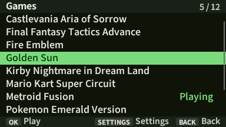
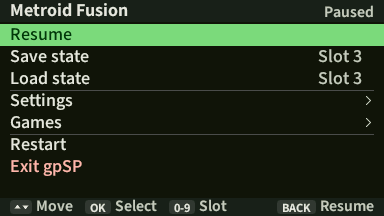
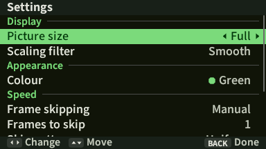
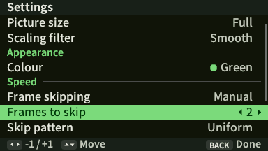
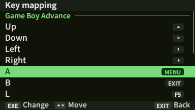
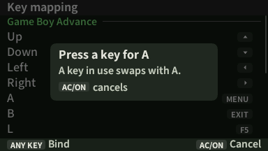
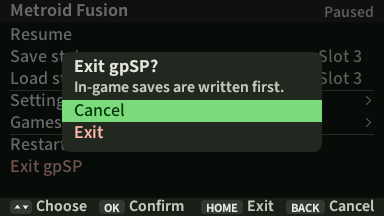
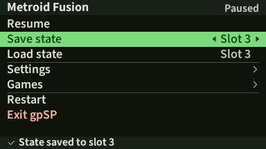
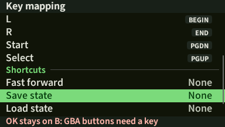
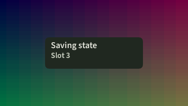

# fx-CG50 / fx-CG100 interface

`ports/fxcg100/cg_ui.c` is the menu of the fx-CG50 and fx-CG100 builds: the
game library, the pause menu, settings and the key-mapping page. It replaces
`fxcg100_menu.c` in the gint builds (the bare-metal `ports/fxcg100/Makefile`
build still uses the old menu) and keeps its contract, so `main()` is shared
with the ClassPad II:

- `fxcg100_menu_init()` sets defaults and loads `CGBA.CFG`;
- `fxcg100_menu_run()` blocks until the player picks something `main()` must
  act on (resume, load a game, restart, save or load a state, exit);
- `fxcg100_menu_should_blit()` is the manual frame skip.

It uses the ClassPad II interface's colour schemes (`classpad_theme.h`) and
drawing code (`classpad_gfx.h`), but not its components: the ClassPad UI is
Material 3 for a touch screen, which on a 384×216 keypad screen spends room
on touch margins and cards and makes the selection hard to see. This one is
a calculator list.

All screenshots below come from the host test (`make -C tests fxcg-ui
FXCG_UI_DIR=dir`), which runs the real drawing code; they are the 384×216 the
layout occupies, at 1:1.

## Layout

| | |
|---|---|
|  |  |
|  |  |
|  |  |
|  |  |

- **One list a page.** ▲▼ move, ◀▶ change the value of the selected row
  (or turn a page of the game list), the confirm key opens or acts. A fresh
  press past the last row goes round to the first, and past the first to the
  last; a held key stops at the end, so holding it never cycles the list.
- **The selection is the strongest thing on screen**: a full-width bar in
  the scheme's primary colour, text in `on_primary`. Nothing else is filled
  with the primary colour.
- **Values sit at the end of their row**, right edge at x = 362, and the
  selected row gets ‹ › around a value the cursor keys change. Changes apply
  at once; Settings writes `CGBA.CFG` when it is left (or when the menu
  closes), so there is no Save config item.
- **Sections** are a 20 px row with a primary-coloured label and a hairline.
- **Header** (22 px): the page title, and on the right where you are (`5 / 12`
  in the library, `Paused` in the pause menu, whose title is the game).
- **Footer** (18 px): keycaps and labels for what the selected row takes, in
  the model's key names. Results ("State saved to slot 3", "Settings saved",
  why a key could not be given) replace the hints for two seconds, or until
  the next key, which then acts as usual. When the
  hints do not fit, the optional ones go first (on the fx-CG100 the library
  drops "Choose", because the SETTINGS keycap is wide).
- **Dialogs** (exit, restart, switch game, press a key) are a box over the
  page, which is redrawn with the scheme darkened by 55 %
  (`cp_theme_toward()`), not blended pixel by pixel. Their choices are rows;
  Cancel is selected first.
- **Sizes**: 22 + 8 × 22 + 18 = 216. Lists scroll a row at a time, keep a row
  of context above and below the selection, and stop on row tops so no sliver
  of a row shows under the header.
- **Text** is Source Sans one weight heavier than on the ClassPad II: titles
  16 px Bold, rows 16 px Medium, labels 14 px Semibold, keycaps 11 px Bold
  (`cg_font.h`). At 16 px a Regular stem is about 1.5 px and looks faint on
  the dark schemes; Medium is 1.8 px. Baselines come from each font's
  descender, so g, p and y never reach the next band (a highlight bar or the
  screen edge would cut them).

## Screen geometry

Both models have the same 396×224 panel (gint's `DWIDTH` × `DHEIGHT`). The
layout is 384×216 at (6, 4), where the fullscreen picture is shown, and every
band (header, footer, highlight bar, the darkening behind a dialog) is painted
out to the panel's edges, so the result looks right whether or not the
6 / 4 px border is visible. The previous menu drew from (0, 0); if the
visible window is 384×216 at (6, 4), its left 6 columns and top 4 rows were
hidden. **Not yet checked on hardware**: a 1 px frame around 384×216 at
(6, 4) would settle it, on either model.

## Keys

| Action | fx-CG50 | fx-CG100 |
|---|---|---|
| Move (held: repeats after 400 ms, every 80 ms) | ▲ ▼ | ▲ ▼ |
| Change a value; turn a page of games | ◀ ▶ | ◀ ▶ |
| Confirm | `EXE` | `OK` or `EXE` |
| Back (in the pause menu: resume) | `EXIT` | `BACK` |
| Pause menu during play; resume from the menu | `AC/ON` | `ON` |
| Settings, from any page | `OPTN` | `SETTINGS` |
| Exit gpSP: asks, the same key again exits | `MENU` | `HOME` |
| Save-state slot, in the pause menu | `0`–`9` | `0`–`9` |
| Take a shortcut's key away | `DEL` | `DEL` |

F1–F6 are not used, so both models have the same footer. The new keys come
from `fxcg100_poll_app_keys()`: `FXCG100_APPKEY_SETTINGS`, `_DEL` and
`_DIGIT(n)`.

## Pages

- **Games** opens first. Before a game runs the footer offers `MENU`/`HOME`
  Exit instead of Back. During play the running game says Playing; picking
  it resumes, picking another asks first (progress since the last save is
  lost).
- **Pause menu**: Resume (selected), Save state and Load state (the slot at
  the end of both rows; ◀▶ or a digit changes it), Settings, Games, Restart
  (asks), Exit gpSP (asks). Saving keeps the menu open: `main()` saves while
  the footer says so, then reopens the menu on the same row with the result
  (`cg_ui_show_progress()`, `cg_ui_set_result()`). Loading returns to the
  game, or reports in the footer if it fails.
- **Settings**: Display (Picture size Original / Full Height / Full Screen,
  Scaling filter, which is hidden for Original since nothing is scaled),
  Appearance (Colour: the eight schemes), Speed (Frame skipping; Frames to
  skip and Skip pattern only when it is Manual; Limit to 60 fps; Show frame
  rate), Keys (Key mapping), and Debug info in `CGBA_DEBUG_MENU=1` builds.
- **Key mapping**: the ten GBA buttons, then the shortcuts (Fast forward,
  Save state, Load state, Show frame rate), then Reset to defaults. The
  confirm key opens "Press a key"; the next key pressed is taken, and the
  menu key cancels. A key that another function uses is **swapped**: that
  function gets the old key. Since every GBA button must have a key (there
  are no touch keys to fall back on), a shortcut with no key cannot take a
  GBA button's key; the footer says why. `DEL` clears a shortcut.

  

Removed from the old menu: ROM SOURCE + LOAD NEW GAME (the library), the
cheats placeholder page, SAVE CONFIG / LOAD CONFIG (saved on leaving
Settings), the Save+Exit shortcut (never implemented; a saved binding is
cleared at start-up) and the Animations switch (nothing moves).

## Drawing and refresh

Nothing animates. Each key press draws the page into VRAM again (cheap), and
then sends to the panel only what changed:

- selection moved, nothing scrolled: the old and new rows, the header and
  the footer (`fxcg100_lcd_update_rows()`, which widens to groups of four
  rows for the R61524 DMA);
- a result appearing or expiring: the footer;
- anything else (a value, a page, a scroll, a dialog, a scheme): the whole
  panel.

Status messages from `main()` ("loading ROM", "Saving state") use
`cg_ui_status()`: a small box over a plain page, or during play over the
game picture, dimmed and placed as the display mode places it.

## Save timings

A build made with `-DCGBA_SAVE_TIMING=ON` (`CGBA_SAVE_TIMING=1
ports/fxcg100/build-docker.sh cg100`, into `build-docker-cg100-timing/`) shows
where a savestate save's time went, from `cgba_last_save_timing`, which every
build records: `pack` (snapshot and compression), `write` (the file, with its
size) and `remap` (asking Fugue for the flash address of every 4 KiB block
of the ROM again, which any change to storage requires). On the fx-CG it is
the footer message, held for 12 s; after a shortcut save, and on the
ClassPad II, it is the second line of the status box.

## Tests

`make -C tests fxcg-ui` builds `tests/fxcg_ui_test.c` for both models against
stub gint headers (`tests/stubs_cgui`), a fake keypad and clock and a
simulated panel. It checks what each key does (exit confirmation, slots,
settings and their rows, key swaps and the refusal, `DEL`, repeat timing,
saving on leaving Settings), that after every step the panel matches VRAM
(so a partial push never leaves a changed row behind), that moving the
selection sends bands rather than the whole screen, that descenders stay in
their band, and that every footer fits.

## Fonts

`cg_font.h` is generated by `tools/classpad_font_gen.c`, which takes a face
index and a weight for variable fonts. The tables were rendered from the
Latin glyphs of Source Han Sans VF (they are Source Sans), because that is
the copy on the machine they were made on; the command line is in the
generator. Rendering from the Source Sans 3 TTFs instead gives nearly, not
exactly, the same pixels. Both are SIL OFL 1.1 (`fonts/OFL.txt`).
`classpad_font_types.h` holds the table layout, so `classpad_gfx.h` can draw
either set without pulling in the other's data.
